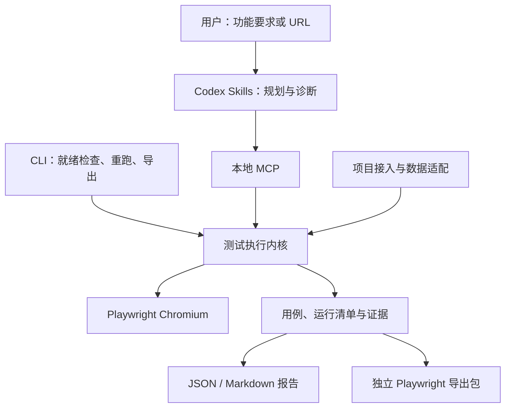

# Design

## Context

本仓库目前只有 OpenSpec 配置，没有产品实现或历史能力规格。动机与首版范围见 proposal.md；行为契约见六个 specs 子目录。

用户已确定两个关键要求：服务本地开发后的验收与回归；能够接入任意前端项目，而非绑定特定框架。这里的兼容边界是可在浏览器中访问的 Web 页面。源码、框架识别、路由映射是增强信息，不是测试入口的必要条件。浏览器可访问不代表业务预期、身份和数据可以自动推断。

以下技术选型是可调整的方案默认值，不是用户额外指定的要求：TypeScript、Node.js 22+、Playwright Chromium、本地 MCP、显式调用。首版验证 macOS、Linux、Windows 的核心 CLI；完整插件安装实机验收先在当前 macOS Codex 宿主进行，其他宿主未经验证时标记兼容状态。

## Goals / Non-Goals

**Goals:**
- 将项目环境适配与浏览器测试逻辑分离，用相同引擎处理不同框架。
- 插件范围内管理依赖、浏览器和默认存储，目标项目保持零侵入。
- Codex 承担非确定性规划与诊断，引擎承担有界执行、断言和证据。
- 每个正式结论可追溯到依据、用例版本和运行证据。
- 一次验收能够产生无模型依赖的回归资产和独立导出包。

**Non-Goals:**
- 首版不建设额外模型服务、账号系统、云浏览器集群或团队测试平台。
- 不依赖宿主内置浏览器 API、某框架编译插件或强制 test id。
- 首版不以视觉推理操作 Canvas，不承诺移动设备硬件等价、全站穷尽覆盖或通用业务预期推断。
- 不将原始 trace 的任意内容脱敏宣称为已解决；敏感原始文件有独立策略。

## Decisions

### 1. 统一执行内核，Skills / MCP / CLI 为入口

采用单仓库、小型模块布局：`src/core/`、`src/project/`、`src/browser/`、`src/artifacts/`、`src/mcp/`、`src/cli/`，以及插件 `skills/`。发布时编译 TypeScript，MCP 和 CLI 使用相同发行版本的内核，避免两套执行语义。开始时不拆分多个 npm 包。

备选：每个框架维护一套测试插件会增加重复维护；只写 Skill 并调用项目测试工具不能保证零侵入与运行一致性；仅依赖当前宿主浏览器会限制 CLI 和宿主迁移。

### 2. 插件包提供运行器，浏览器资源单独准备

插件发行包携带已构建入口和声明依赖；Chromium 二进制放在插件用户缓存，使用与锁定 Playwright 版本匹配的资源。`doctor` 检查 Node、浏览器、执行权限及存储，`setup` 提供插件范围的准备路径。Node 与浏览器依赖属于明确运行条件，零侵入并不等于零环境准备。

macOS 使用用户缓存目录，Linux 遵循 XDG，Windows 使用本地应用数据目录；用户可以覆盖存储根目录。默认不在目标项目落文件。目标应用缺失自身依赖时报告阻塞，不自动运行安装命令。

备选：每个目标项目安装 Playwright 容易污染依赖；将浏览器打进插件包会增加体积与平台分发成本。

### 3. 通用接入协议，发现只是辅助

输入至少具备以下组合之一：明确 URL；项目路径及可确定的启动命令；项目路径及已运行地址。先检查显式信息，再读取选定的 `webpilot.config.json`，最后发现 package scripts、锁文件、README 和框架配置。读取发现信息不执行其中命令。

项目适配输出目标描述：应用根目录、地址及来源、启动参数、就绪条件、登录态引用、数据生命周期和测试预算。多应用、多个启动脚本或多端口没有可靠唯一候选时返回待选择状态。启动命令以 executable / args / cwd 表达，Shell 模式需要明确配置，不把页面或日志内容插入命令。

未知框架继续走 URL 接入；原生 HTML 可通过显式地址或选定目录的静态服务接入，静态服务只暴露指定目录。现有测试文件提供参考，首版不承诺自动导入任意测试框架。

就绪检查根据配置的 HTTP 条件或启动结果验证目标，保留最终访问 URL。非 2xx 登录重定向等情况需要显式就绪条件，不一律视作应用失败。

### 4. 服务、角色和数据生命周期明确归属

已有服务只复用，不杀进程。引擎启动的服务带运行所有权，取消、超时和退出时清理自己创建的进程树。异常退出后的清理只依据可验证的进程身份，不仅凭旧 PID。

每个用例在独立 context 中执行，角色通过外部 `storageState` 引用或显式登录步骤进入。数据准备和清理由选定项目配置提供命令或 fixture 模块；执行前解析引用并应用宿主权限。即使用例失败，也尝试清理。清理失败独立报告，运行不能被描述为完整稳定通过。

录制后的用例晋升回归前重新执行 prepare、创建 context、重跑、cleanup，防止探索留下的状态产生虚假成功。

备选：共享用户日常浏览器会增加角色污染；假设能从界面自动恢复所有业务数据不可靠。

### 5. Codex 规划，结构化用例承载执行

Codex 读取用户要求、OpenSpec、已有用例和可选 diff，产生可校验验收计划。引擎不内置额外模型调用，CLI 重跑不需要模型凭证。

统一数据模型：
- `TargetProfile`：目标、来源、配置、角色、数据引用、预算和能力标记。
- `AcceptancePlan`：范围、用例、候选检查、来源冲突和覆盖缺口。
- `Case`：稳定 id、schemaVersion、用例版本、前置条件、步骤、断言及来源。
- `RunRecord`：计划版本、用例结果、各次尝试、环境、预算、覆盖与清理状态。
- `EvidenceRef`：run / case / attempt / step 关联、类型、脱敏状态、存储引用和采集时间。完整流程录像属于 attempt 级证据，步骤截图和快照仍属于 step 级证据。

来源记录类型、文档或需求引用、可得版本和采纳记录。来源冲突的正式断言暂停，候选检查可以探索但不能证明业务验收通过。不存在正式标准时报告无法确定，用户采纳候选后才赋予正式依据。

结构化步骤采用有版本的操作集合，支持 navigate、click、fill、select、check、press、scroll、frame/page 切换、upload、download 检查，以及 expectVisible / Text / URL / Count / Value / Enabled。定位描述记录 role / label / text / testId / 显式 selector 与限定范围。运行时变量记录引用，不把秘密值写入用例。

首版不提供任意浏览器脚本执行步骤。引擎检查结构版本和可执行操作，不执行模型生成的任意代码。

备选：直接生成自由格式测试代码虽然灵活，但难以一致校验来源、等待和维护变更；仅保存自然语言无法实现确定性重跑。

### 6. 探索和回归共用动作与断言语义

探索时通过 `observe → act → check` 获取快照、执行动作和验证结果，成功步骤可转成用例草稿。页面内容属于观察数据，不为启动命令、范围变更或修改业务标准提供授权。

优先语义定位，定位操作要求唯一匹配；存在歧义时返回候选上下文，Codex 根据新观察收窄范围。保存可回归用例时记录明确定位，不在重跑中调用模型自由换目标。iframe 和新页面记录关联与切换语义，跨来源跳转按目标配置范围处理，意外目标停止并报告。

使用 Playwright 的自动等待和明确断言；页面就绪以目标条件为准，不把固定 sleep 或 networkidle 当作通用成功条件。预算默认单次运行 10 分钟、100 个动作、单个检查 10 秒、一次尝试，均可覆盖；MCP 增量操作共享运行预算，不允许重开工具调用绕过上限。

### 7. 状态与汇总有明确算法

用例状态：
- `passed`：有效前置条件下，所有必需正式断言有执行证据且满足。
- `failed`：有效前置条件下，正式断言被观察为不满足。
- `blocked`：环境、权限、身份、数据等必要条件不可满足。
- `inconclusive`：依据或证据不足、能力缺口、取消或预算耗尽留下未验证部分。

运行汇总保留完整计数；总体主状态依次按 failed、blocked、inconclusive、passed 选择，但主状态不覆盖其他结果。无正式用例时总体为 inconclusive。重试结果保留每次尝试，后续通过附加 unstable 标记，不能称为稳定通过。清理失败使总体验收不完整。

CLI 退出状态：0 为完整稳定通过，1 为存在正式断言失败，2 为阻塞、无法确定或只有重试后通过，3 为运行器内部错误或无效调用；报告保留更细分类。JSON 输出写 stdout，诊断写 stderr。

### 8. 证据按敏感程度处理

每个步骤关联快照、脱敏截图、控制台摘要和网络失败元数据；默认不采集正文及认证头。已识别凭证和用户配置敏感字段在保存与 MCP 返回之前过滤。截图先按配置遮挡敏感区域；遮挡失败则省略图片并留下原因。记录缺口，不能承诺自动发现所有业务敏感信息。

Playwright 原始 trace 可能包含 DOM、截图及网络秘密，默认关闭原始保存。项目显式启用 `retain-raw-local` 后，原始 trace 保留在受限本地目录，标为敏感，不进入 MCP/模型返回或测试导出。安全步骤摘要仍默认提供。原始 trace 保留默认 7 天，可覆盖；自动清理只针对标记为插件所有的过期运行文件，不清除已保存用例与用户原文件。

Playwright 流程录像默认对每次浏览器尝试开启，成功、失败及重试均保留，并在报告中提供本地播放入口；用户可按目标显式关闭。每个尝试的录像在 context 关闭后定稿并关联到 attempt；多页面 context 可能产生多段录像，报告需列出对应页面。视频无法可靠执行运行时脱敏，故标为敏感本地证据，不把视频内容或原始文件传给 MCP/模型或测试导出。录像沿用 `retentionDays`，默认 7 天；无法生成录像时报告证据缺口，不影响断言结果。

报告采用 JSON 和 Markdown，不要求专门报告服务器；可读报告引用本地截图、录像与受控证据。代码位置与根因诊断属于有来源的建议，运行器断言结果独立保存。

### 9. 回归与导出使用同一套操作映射

用例状态包括 draft 和 regression-ready。仅正式断言依据完整、无冲突且独立重跑通过时晋升。用例不可变版本与运行记录分开；修改定位产生差异，改变断言必须记录新的业务依据，自动建议不覆盖原结果。

CLI `replay` 解释结构化用例。导出器使用相同操作定义生成 `@playwright/test` 测试、配置、依赖说明和准备接口，输出到指定目录，遇到文件冲突不覆盖。导出包无需安装 WebPilot，不包含账号秘密、登录态文件或机器专属登录路径；这些通过环境或外部引用提供。

使用等价目标和重置数据验证原资产与导出包的正式断言。未实现的步骤或缺少外部 fixture 不静默丢弃，导出清单记录问题，包保持未验证状态。独立导出验证过程发生在导出目录，不修改目标项目。

### 10. 插件封装与工具接口

按照当前官方文档，优先根 `plugin.json`、`skills/` 和 MCP 配置，必要时加兼容 overlay。计划采用本地 stdio MCP，发行包提供固定入口，不通过插件初始化脚本临时下载执行未知代码。具体清单 schema 与本地 transport 支持在第一个实施里程碑中核对并实机验证；若宿主限制本地组件，应先解决发行入口，不能在未验证装载路径的情况下展开全部实现。

拟定工具面：`project_inspect`、`run_prepare`、`session_open`、`session_observe`、`session_act`、`session_check`、`session_close`、`suite_run`、`report_read`、`case_save`、`case_export`。这些是设计名称，最终 schema 在契约任务中冻结。结果包含接口版本、运行/会话 id、状态、数据和结构化错误；过期会话与不支持 schema 提前拒绝。

Skills 聚焦 verify、replay、diagnose、export 四个用户目标。首版不用生命周期 hook；宿主沙箱与批准策略仍适用，不通过浏览器执行层绕过宿主限制。

参考已读取的官方文档：[Package your plugin](https://developers.openai.com/plugins/build/plugins)。该文档区分本地发行与公开目录发行；本方案只承诺本地发行，公开目录发布另行评估。

### 11. 用兼容矩阵与已知缺陷验证产品

框架样例包含 React/Vite、Vue/Vite、Next.js、静态 HTML、monorepo，覆盖 SPA、SSR/水合和无源码 URL。统一验证登录、表单提交、列表筛选，以及 iframe、新页面、上传下载的辅助样例。样例框架不是生产接入白名单。

已知缺陷集包含按钮无响应、错误提示缺失、请求失败、定位歧义、延迟加载、登录态过期和数据准备失败。将产品失败与环境阻塞分别标注，预期状态准确匹配，不依赖 AI 诊断措辞一致。

发布门槛：五类样例都完成接入、验收、保存、独立重跑和导出闭环；稳定回归连续五次运行满足预期；目标项目源码、依赖与锁文件哈希不变；已知缺陷的正式状态分类及敏感信息过滤契约测试全部通过。记录耗时、成功率与缺陷识别结果；真实模型交互消耗另作观察指标，不用未经测量的数值承诺。

## Risks / Trade-offs

- [框架识别不覆盖所有工程结构] → 发现结果不是入口门槛，显式 URL、命令和工作目录始终可用。
- [业务预期无法仅从页面推断] → 断言追溯来源，推测保持候选，缺少标准报告无法确定。
- [语义不足的 Canvas、自定义控件] → 明示首版能力缺口，后续单独扩展视觉操作，不降低定位唯一性要求。
- [动态数据与依赖服务导致不稳定] → 项目生命周期配置、独立上下文、重跑验证和不隐藏重试结果。
- [零侵入但仍需要浏览器/系统环境] → doctor/setup 检查插件条件，明确区分目标项目准备与插件准备。
- [trace、截图和录像泄露信息] → 原始 trace 显式启用；默认录像标为敏感本地证据，不上传内容，提供关闭开关并按保留期清理；截图按配置遮挡，在报告列明证据缺口。
- [不同 Codex 宿主的本地插件支持差异] → 首个里程碑实机验证，兼容状态可见，CLI 保持独立可用。
- [导出与解释执行行为漂移] → 共用动作映射，并在相同前置条件下验证两种执行结果。
- [第一版范围包含多种交互，交付过大] → 按下列里程碑逐层闭环，每层满足对应契约后再扩展。

## Migration Plan

本项目是新增产品，没有历史数据迁移。

1. M0：本地插件装载验证、运行时就绪检查、共享数据契约和最小 URL 验证。
2. M1：项目发现、服务生命周期、登录态和数据准备，打通常见表单验收。
3. M2：规划与来源管理、完整证据报告、常见交互及取消/预算处理。
4. M3：回归资产、独立重跑、Playwright 导出及维护差异。
5. M4：跨框架矩阵、核心 CLI 跨平台验证、已知缺陷集与安装指南。

本地 marketplace 指向版本化发行包，发布前验证新会话加载。回滚可切换到前一发行版本；运行记录和用例保留，旧运行器遇到更高 schemaVersion 时显式拒绝。未来资产迁移必须产生备份和可审查差异，不静默覆盖。

## Open Questions

- 插件正式展示名称、图标和发行许可证：默认沿用 WebPilot，发布前确定，不影响行为契约。
- 可补充真实参考项目作为额外兼容性样例；已有五类样例及门槛足以开始实施。
- 团队 CI 平台、视觉回归和多浏览器的优先级，在首版闭环完成后决定。
